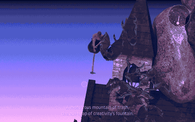

# Getting Over It, played by reinforcement learning

  

**The first reinforcement learning agent to finish the whole game in one continuous run.** One network by
[@krzim](https://github.com/krzim), trained only in a JAX re-implementation of the game built on this repo's plugin,
plays the real *Getting Over It with Bennett Foddy* from the bottom to the top with no save/load. It won 17 of 20
climbs in krzim's test. Above, 30 s of one of its wins recorded here, from the anvil to the radio mast; the whole
climb took 2 min 34 s ([full video](https://huggingface.co/miiwater/goi-rl/blob/main/videos/krzim-network-wins.mp4)).
The circle in the corner is the network's mouse input.

## How it works

- A C# plugin (BepInEx) runs inside the game and connects it to Python: physics advances in lockstep with the agent,
  and the whole game can be saved and restored exactly.
- krzim re-implemented the game's physics engine (Box2D 2.3.1, as Unity runs it) in JAX, batched over thousands of
  worlds on a GPU, and checked it against step-by-step recordings of the real game made through the plugin. The
  physics port is in this repo (`goi_jax/box2d`, with Box2D's [license notice](goi_jax/box2d/LICENSE-Box2D.txt)).
  The game rules and the trainer built on it are in
  [krzim's fork](https://github.com/krzim/getting-over-it-rl/tree/jax-engine), and the winning network with the logs
  of its 20 climbs is on [krzim's Hugging Face](https://huggingface.co/zimmerk4/getting-over-it-rl-jax).
- This repo's own networks train in the real game: PPO (Stable-Baselines3) on 10 copies at once, 28 networks each
  specialized in one stretch of the route and chained along it, started from states a save/load search found. Their
  best continuous game from the bottom reached 63% of the way to the top.

## Models

This repo's networks and videos are on [Hugging Face](https://huggingface.co/miiwater/goi-rl).

## License

MIT. See [LICENSE](LICENSE).
